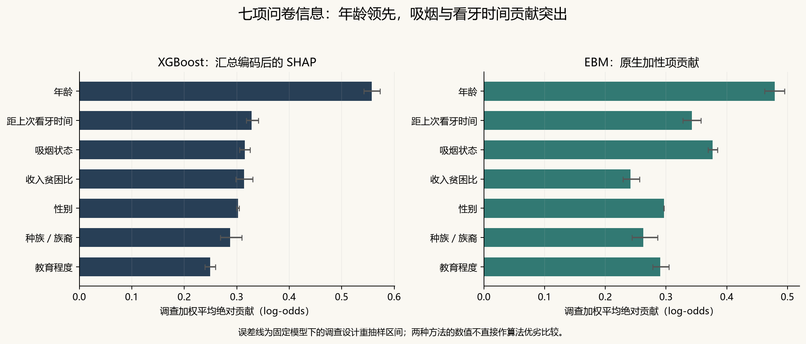
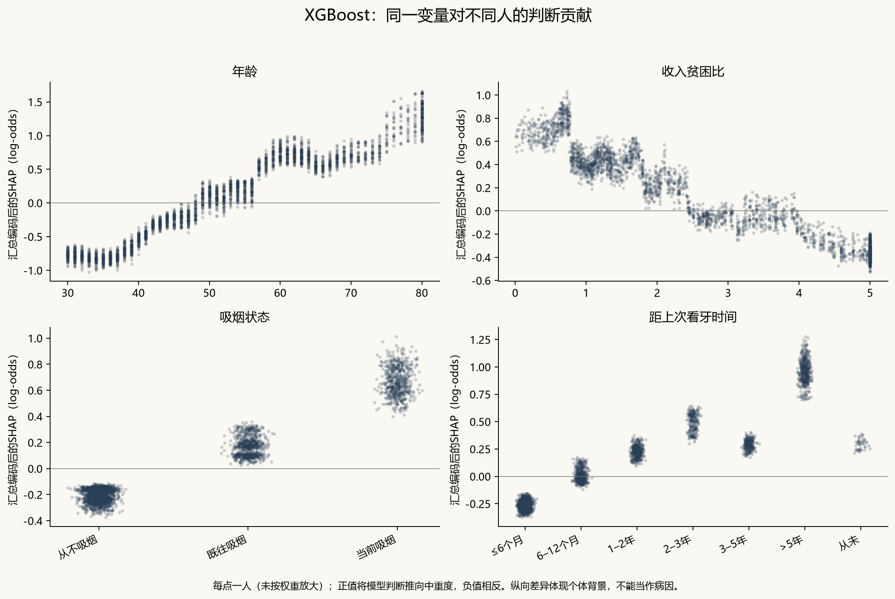
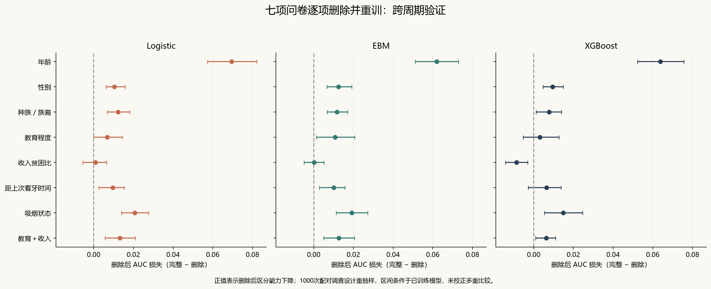
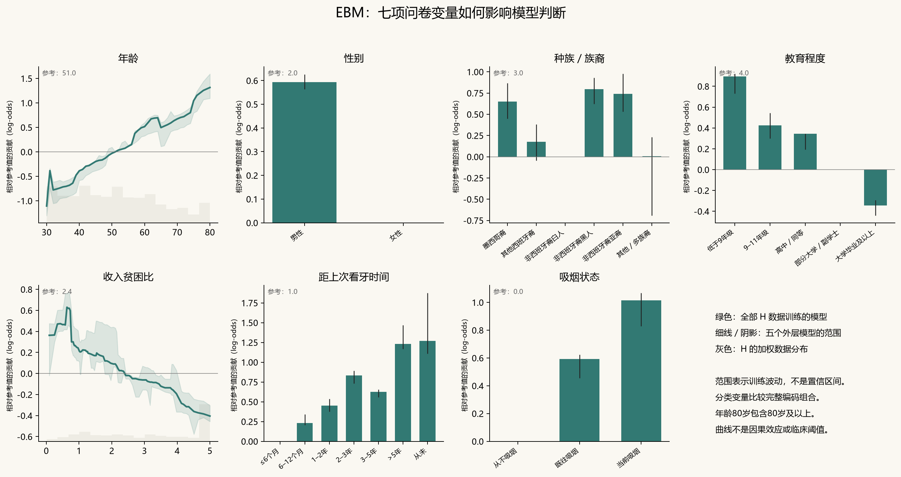
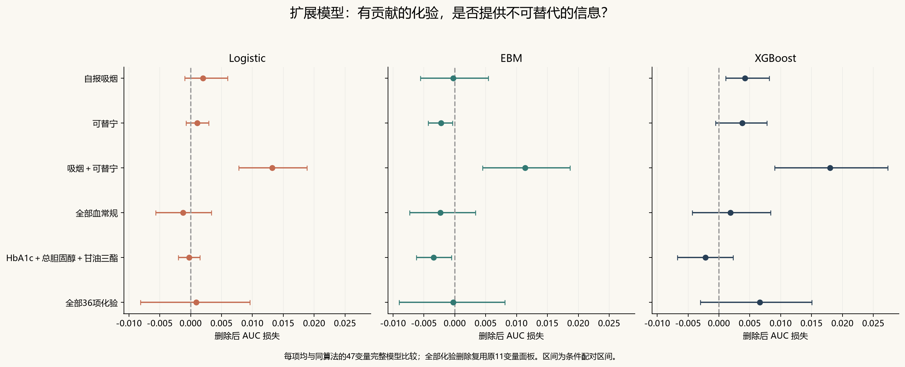
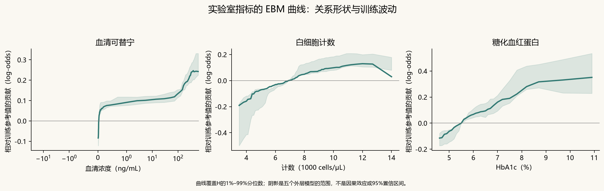

# NHANES 可解释性补充研究：SHAP、EBM 曲线与删除变量重训

完成日期：2026-10-11。此为原跨周期研究的探索性补充，不替代原研究设计。

## 这次分析得到什么

1. **年龄与吸烟是最稳定的问卷信号。**删除年龄后，三个模型的G验证AUC损失分别约0.062–0.070；删除吸烟损失约0.015–0.021，条件配对区间均在0以上。看牙时间的损失约0.006–0.010，但XGBoost区间跨0，不能说三种模型都有明确独立收益。
2. **教育与收入应该同时看。**收入在问卷XGBoost的SHAP排序第4，却在删除并重新调参后使G的AUC提高约0.0087；Logistic和EBM单删收入的区间跨0。然而，同时删教育与收入时，三个模型的AUC都下降，条件区间均在0以上。这支持把社会经济信息作为一组研究，不能仅按贡献排序决定保留哪一项。
3. **自报吸烟与可替宁提供部分可替代的信息。**在47变量模型中，单独删除任一项的损失较小，联合删除损失约0.011–0.018，三个模型的条件区间均在0以上；在另一项缺失时，保留这一项有预测价值。XGBoost单删自报吸烟仍有小幅损失，说明不是完全互换。这个结果更接近“烟草暴露信息的重要性”，不能认定可替宁检测具有稳定的额外采集价值。
4. **有可见的化验曲线，不等于有稳定增量。**血常规整组及三项糖脂指标删除后，没有一致的区分能力损失。EBM删可替宁或糖脂小组时AUC反而小幅提高，属于模型和周期特定的探索结果；不能推出这些指标与牙周炎无关。

所有“区间在0以上／以下”均指固定模型下、未校正多重比较的探索性区间。不能根据已看过的G结果反向挑出一个六变量模型，再把同一个G当作其全新验证；任何精简后的正式模型都需要新的验证。

## 研究问题与设计

主要问题：七项问卷信息中的哪些内容承载了预测信号？实验室指标是否提供了已有信息无法替代的增量？研究当前可观察牙周检查成人的中重度牙周炎识别，不研究未来发病或病因。

开发为2013–2014 H周期（n=3617），验证为2011–2012 G周期（n=3323）。结局、纳入域、权重及PSU分组沿用主研究。14种删除方案 × Logistic、EBM、XGBoost，共42套新流程；每套5个外层模型和1个全部H模型，共252个保存模型。每次外层训练及最终训练均独立进行3折PSU分组内部选择，两组候选参数与原研究相同。包含内部候选训练共1764次拟合。删除年龄时完整移除Logistic年龄样条，未保留隐藏年龄输入。

方案在本次训练前写入analysis_plan.json；G周期先前已被分析，且变量优先级参考了既往结果，因此不是前瞻性预注册或全新盲测。所有新模型只在H训练和调参；训练脚本不读取G。原数据、原模型及原结果文件的SHA256保持一致。

## 解释方法

XGBoost采用TreeSHAP解释原始log-odds，主要设定为interventional。每个模型的背景集从对应H训练样本按调查权重有放回抽128次；背景不含该外层验证样本，也不含G。另对G做tree_path_dependent敏感性分析。分类哑变量和缺失指示项的归因相加回原始变量，因此报告的是“汇总编码后的归因”；这不是重新估计的原变量组联盟Shapley值。编码层的interventional设定可能产生不现实的分类组合，需结合路径设定稳定性及成组删除判断。

EBM保持interactions=0，直接提取加性项eval_terms，并按原始变量汇总。连续曲线覆盖H中1%–99%分位数；分类图比较完整合法编码。图上贡献以相同的H中位数／众数为参考，单位log-odds，不能解释成风险百分比。五个外层模型曲线的范围展示训练波动，不是95%置信区间。年龄80岁为公开数据顶端编码，包含80岁及以上。

H解释来自各外层留出样本，G解释来自全部H训练的最终模型。全局贡献使用调查加权平均绝对贡献。贡献总和加截距必须重建模型判断，逐模型检查加性及概率重建误差。

删除方案重新插补、重新变换、重新内部选择并训练。保留相同样本，不因删除变量改变纳入人数。对H外层预测和G验证预测实施1000次配对Rao-Wu重抽样，从各周期全部正MEC权重设计中抽PSU，比较AUC损失（完整−删除）及Brier增加（删除−完整）。正值表示删除后变差。区间条件于已训练模型，不包含完整训练和背景抽样不确定性，未校正多重比较；不能据此作等效性或临床重要性结论。

## 七项问卷信息的贡献

| 面板 | 方法 | 贡献排序（前列） |
| --- | --- | --- |
| Questionnaire | XGBoost | 年龄、距上次看牙时间、吸烟状态、收入贫困比、性别、种族／族裔、教育程度 |
| Questionnaire | EBM | 年龄、吸烟状态、距上次看牙时间、性别、教育程度、种族／族裔、收入贫困比 |
| Expanded | XGBoost | 年龄、收入贫困比、距上次看牙时间、性别、种族／族裔、血清可替宁、吸烟状态、教育程度 |
| Expanded | EBM | 吸烟状态、距上次看牙时间、性别、教育程度、年龄、种族／族裔、收入贫困比、血清可替宁 |

重要性是模型输出的归因强度，不是删除后的性能损失。EBM和SHAP的绝对数值及排名不要求一致，也不能跨算法直接把更大的贡献数值当作更好的模型。

## 删除问卷变量后的验证结果

| 删除的信息 | Logistic AUC损失 [95%区间] | EBM AUC损失 [95%区间] | XGBoost AUC损失 [95%区间] |
| --- | --- | --- | --- |
| 年龄 | 0.0695 [0.0573, 0.0822] | 0.0620 [0.0511, 0.0729] | 0.0638 [0.0523, 0.0757] |
| 性别 | 0.0104 [0.0062, 0.0159] | 0.0124 [0.0066, 0.0192] | 0.0095 [0.0046, 0.0148] |
| 种族／族裔 | 0.0123 [0.0068, 0.0181] | 0.0117 [0.0068, 0.0170] | 0.0078 [0.0013, 0.0139] |
| 教育程度 | 0.0068 [-0.0000, 0.0144] | 0.0107 [0.0014, 0.0207] | 0.0031 [-0.0053, 0.0127] |
| 收入贫困比 | 0.0009 [-0.0055, 0.0065] | 0.0002 [-0.0049, 0.0051] | -0.0087 [-0.0143, -0.0031] |
| 距上次看牙时间 | 0.0096 [0.0025, 0.0154] | 0.0101 [0.0028, 0.0157] | 0.0065 [-0.0028, 0.0138] |
| 吸烟状态 | 0.0206 [0.0140, 0.0277] | 0.0192 [0.0113, 0.0272] | 0.0149 [0.0054, 0.0246] |
| 教育＋收入 | 0.0132 [0.0057, 0.0209] | 0.0126 [0.0050, 0.0205] | 0.0063 [0.0009, 0.0110] |

- 删除年龄：Logistic 外部 AUC 损失 0.0695 [0.0573, 0.0822]，Brier 增加 0.0224 [0.0177, 0.0273]。
- 删除吸烟：Logistic 外部 AUC 损失 0.0206 [0.0140, 0.0277]，Brier 增加 0.0089 [0.0064, 0.0120]。
- 删除看牙时间：Logistic 外部 AUC 损失 0.0096 [0.0025, 0.0154]，Brier 增加 0.0034 [0.0010, 0.0055]。
- 删除教育＋收入：Logistic 外部 AUC 损失 0.0132 [0.0057, 0.0209]，Brier 增加 0.0048 [0.0021, 0.0074]。

## EBM 关系形状

曲线说明模型学到的关系，不能将视觉转折点命名为临床阈值。看牙时间同时可能反映医疗可及性、预防行为和有症状后的就诊；种族／族裔可能承载社会结构信息，不能解释为天生生物学机制。教育与收入分别及联合删除用于检验信息重叠，而非估计社会因素的因果效应。

## 自报吸烟与可替宁：互补还是冗余

- Logistic：只删自报吸烟损失 0.0020 [-0.0010, 0.0060]；只删可替宁损失 0.0011 [-0.0007, 0.0029]；同时删两者损失 0.0132 [0.0078, 0.0188]。
- EBM：只删自报吸烟损失 -0.0003 [-0.0056, 0.0054]；只删可替宁损失 -0.0022 [-0.0043, -0.0004]；同时删两者损失 0.0114 [0.0045, 0.0187]。
- XGBoost：只删自报吸烟损失 0.0042 [0.0011, 0.0081]；只删可替宁损失 0.0037 [-0.0005, 0.0078]；同时删两者损失 0.0180 [0.0090, 0.0273]。

额外对“无可替宁时删除吸烟”和“无自报吸烟时删除可替宁”做直接配对比较，结果见deletion_comparisons.csv的conditional_deletion。联合删除不能用两个单独损失简单相加，也不能把非相加性称为已证实的生物学交互。

可替宁的加权缺失比例为H约2.85%、G约4.17%；自报吸烟约0.03%、0.04%。归因包含训练插补及缺失指示项的贡献，因此不能把全部可替宁归因都解释成浓度的生物学作用。全部变量的缺失信息见missingness.csv。

## 实验室信息的删除重训

| 删除的信息 | 模型 | AUC损失 [95%区间] | Brier增加 [95%区间] |
| --- | --- | --- | --- |
| 自报吸烟 | Logistic | 0.0020 [-0.0010, 0.0060] | 0.0015 [0.0005, 0.0028] |
| 自报吸烟 | EBM | -0.0003 [-0.0056, 0.0054] | 0.0007 [-0.0014, 0.0032] |
| 自报吸烟 | XGBoost | 0.0042 [0.0011, 0.0081] | 0.0017 [0.0008, 0.0029] |
| 可替宁 | Logistic | 0.0011 [-0.0007, 0.0029] | 0.0008 [-0.0000, 0.0016] |
| 可替宁 | EBM | -0.0022 [-0.0043, -0.0004] | -0.0003 [-0.0012, 0.0005] |
| 可替宁 | XGBoost | 0.0037 [-0.0005, 0.0078] | 0.0013 [-0.0004, 0.0028] |
| 吸烟＋可替宁 | Logistic | 0.0132 [0.0078, 0.0188] | 0.0077 [0.0059, 0.0095] |
| 吸烟＋可替宁 | EBM | 0.0114 [0.0045, 0.0187] | 0.0065 [0.0043, 0.0091] |
| 吸烟＋可替宁 | XGBoost | 0.0180 [0.0090, 0.0273] | 0.0073 [0.0048, 0.0098] |
| 全部血常规 | Logistic | -0.0012 [-0.0056, 0.0034] | -0.0017 [-0.0038, 0.0003] |
| 全部血常规 | EBM | -0.0023 [-0.0073, 0.0033] | -0.0015 [-0.0034, 0.0004] |
| 全部血常规 | XGBoost | 0.0019 [-0.0043, 0.0084] | -0.0002 [-0.0022, 0.0020] |
| HbA1c＋总胆固醇＋甘油三酯 | Logistic | -0.0003 [-0.0020, 0.0015] | 0.0004 [-0.0003, 0.0012] |
| HbA1c＋总胆固醇＋甘油三酯 | EBM | -0.0035 [-0.0062, -0.0005] | -0.0005 [-0.0018, 0.0008] |
| HbA1c＋总胆固醇＋甘油三酯 | XGBoost | -0.0022 [-0.0067, 0.0023] | -0.0000 [-0.0018, 0.0020] |
| 全部36项化验 | Logistic | 0.0009 [-0.0081, 0.0096] | -0.0013 [-0.0058, 0.0026] |
| 全部36项化验 | EBM | -0.0002 [-0.0090, 0.0081] | -0.0018 [-0.0043, 0.0006] |
| 全部36项化验 | XGBoost | 0.0066 [-0.0030, 0.0150] | 0.0013 [-0.0023, 0.0044] |

血常规作为10项完整检测面板删除。代谢小组仅指HbA1c、总胆固醇、甘油三酯三项，不能概括成删除全部代谢信息。可替宁、白细胞及HbA1c展示曲线；白细胞没有单独删除重训，不能把整组删除结果归到白细胞一项。

“删除全部36项化验”复用原11变量NonLabBP模型；“删除血压”复用原9变量NonLab模型；“删除全部体测和血压”复用原7变量模型。它们接受同样的嵌套训练协议，但有不同维度、编码顺序与随机列采样；差异应理解为完整建模流程的变化。

## 稳定性与证据边界

| key | comparison | spearman_importance |
| --- | --- | --- |
| Questionnaire_XGBoost | H_OOF_vs_G | 0.893 |
| Questionnaire_XGBoost | SHAP_interventional_vs_path | 0.964 |
| Questionnaire_EBM | H_OOF_vs_G | 1.0 |
| Expanded_XGBoost | H_OOF_vs_G | 0.978 |
| Expanded_XGBoost | SHAP_interventional_vs_path | 0.999 |
| Expanded_EBM | H_OOF_vs_G | 0.943 |

秩相关描述排序稳定性，未进行显著性检验；不能证明每个人的方向均相同。固定模型条件区间不包含模型训练的不确定性。两周期都来自美国NHANES相邻时期，不能替代中国人群验证。

本次分析将“模型使用的信息”与“删除后不可替代的信息”分开：某项指标可以有较高归因贡献，但因其他变量提供相似信息，删除后性能变化有限。不能从贡献高推断病因，也不能从增量区间跨0推断指标无用。

## 复现与文件

入口：README_先读.md；完整结果：performance.csv、deletion_comparisons.csv、importance.csv、importance_stability.csv、ebm_shapes.csv；受试者级归因：explanations/；模型：models/；检查：verification.json、explanation_checks.json、prediction_replay_checks.csv、preservation_after.json；源码：src/。图提供PNG及PDF。

复现顺序：explainability_extension.py plan；train --algorithm Logistic／XGBoost／EBM；explain；evaluate；deliver_explainability.py。训练断点从独立文件恢复，完成结果不重复训练。

## 方法来源

- [SHAP TreeExplainer 官方文档](https://shap.readthedocs.io/en/latest/generated/shap.TreeExplainer.html)：输出尺度、背景及特征依赖设定。
- [InterpretML EBM 官方API](https://interpret.ml/docs/python/api/ExplainableBoostingClassifier.html)：加性项、eval_terms与模型结构。
- 调查设计与结局来源沿用主研究及保存的CDC代码簿。
